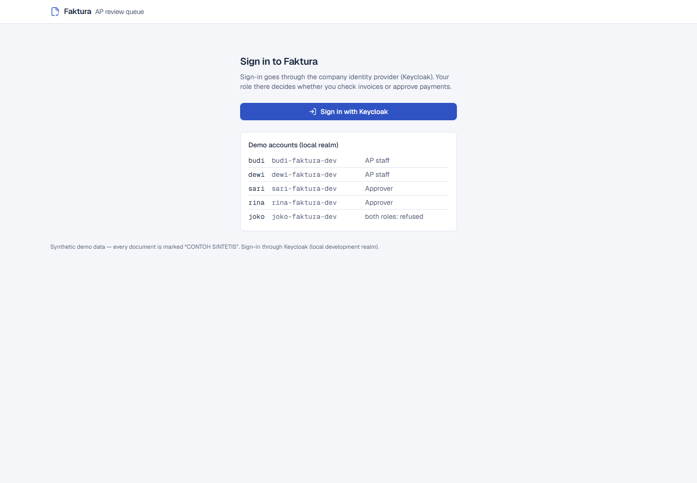
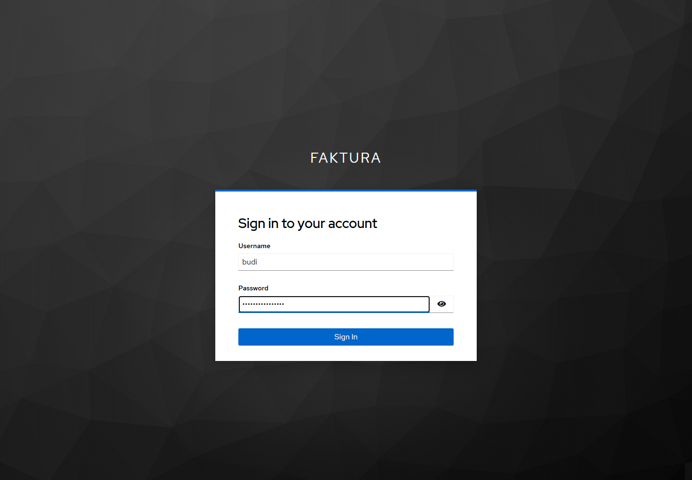

# Sign-in: Keycloak (OIDC)

Faktura moves money, so "who did this" has to be proven, not stated. Users sign in
through Keycloak; the role Keycloak gives them decides what they may do, and their
username is the actor in the audit trail.



## How it fits together

```
browser ──cookie──▶ Next.js (faktura-web) ──Bearer access token──▶ FastAPI
   │                     │  confidential OIDC client                 │ verifies signature,
   └──login form──▶ Keycloak ◀──code + PKCE, refresh──┘              │ issuer, audience, expiry
                    realm "faktura"  ◀──────── signing keys (JWKS) ───┘
```

- **Web (backend-for-frontend).** Next.js is a confidential client using the
  authorization code flow with PKCE (`openid-client`). Tokens never reach the browser:
  they live in one encrypted, httpOnly cookie (`jose`, A256GCM) that only the Next server
  can read. `proxy.ts` sends anyone without a session to `/login` and refreshes an access
  token shortly before it expires (they live 5 minutes).
- **API.** Every route, reads included, requires `Authorization: Bearer <access token>`
  (`src/faktura/app/auth.py`). The token must be signed by the realm's key (fetched from
  JWKS and cached; a new key id triggers one refetch), issued by the `faktura` realm, meant
  for `faktura-api` (an audience mapper on the client adds it), unexpired, and an access
  token (Keycloak's `typ: Bearer`), not an ID or refresh token. Headers like `X-User` are
  ignored.
- **Roles.** Realm roles `ap_staff` and `approver`. An account must hold exactly one: one
  holding both could prepare an invoice and approve it in another session, so it is
  refused at sign-in and by the API. Maker-checker inside the workflow still applies on
  top of this.

| Failure | Result |
|---|---|
| No token, bad signature, wrong issuer or audience, expired, ID token | 401 |
| Valid token, no Faktura role or both roles | 403 |
| Keycloak unreachable when keys are needed | 503 (never "let them in") |
| Keycloak refuses a refresh (session ended, user disabled, role removed) | signed out |

Because a role change reaches the session at the next refresh, removing someone's role in
Keycloak takes effect within 5 minutes.

## Run it

```bash
docker compose --profile sso up -d keycloak     # realm imported on first start
cp web/.env.example web/.env.local              # then set FAKTURA_SESSION_SECRET
uv run uvicorn faktura.app.api:app --port 8077  # FAKTURA_AUTH=oidc is the default
cd web && npm run build && npm start            # http://127.0.0.1:3077
```

Keycloak's admin console is at http://127.0.0.1:8180 (admin / admin-dev). Port 8180,
not 8080, to stay clear of other local services.

The realm (`keycloak/faktura-realm.json`) defines the roles, the `faktura-web` client
(code flow only, PKCE S256 required, no password grant, exact redirect URI), brute-force
lockout, a 12-character password policy, and demo users:

| User | Role | Password |
|---|---|---|
| budi, dewi | AP staff | `<user>-faktura-dev` |
| sari, rina | Approver | `<user>-faktura-dev` |
| joko | both: refused | `joko-faktura-dev` |

`FAKTURA_AUTH=dev` switches the API back to trusting `X-User` / `X-Role` headers, for the
test suite and local scripts only. It must be set explicitly: a missing setting means
OIDC, so a forgotten variable never turns authentication off.



## Verified

- `tests/test_auth.py`: tokens signed with a key generated in the test. Accepted when
  valid; 401 for no token, another key, expired, another audience or realm, an ID token,
  no expiry, `alg: none`, or garbage; header spoofing ignored; dual-role and no-role
  accounts get 403; an unreachable Keycloak gives 503.
- `scripts/e2e_demo.py` signs in through the real Keycloak form: Joko (both roles) is
  turned away with no session created, Budi corrects an invoice, Sari approves it, and the
  bill is posted to Odoo. The audit trail shows `budi` and `sari` as actors.
- A session left idle past the access token's lifetime is refreshed in place, and after
  sign-out the queue redirects to the sign-in page.

## Before production

Development defaults that a real deployment changes: HTTPS everywhere (`sslRequired`,
secure cookies follow `APP_URL`), Keycloak on a real database (`start`, not `start-dev`),
a generated client secret, users from the company directory (LDAP / Active Directory
federation) instead of the demo users, and MFA for approvers.
