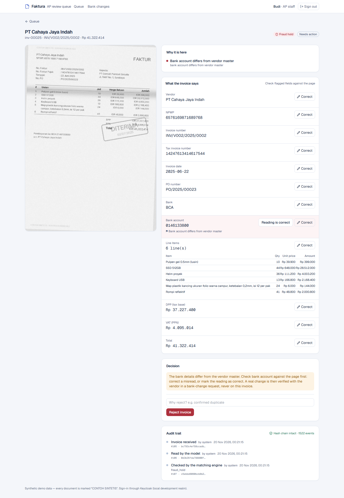
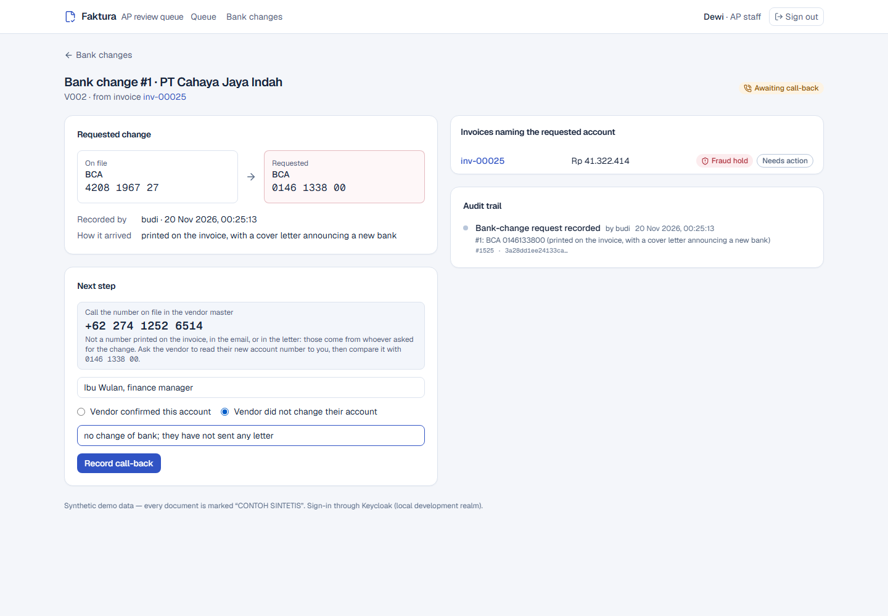
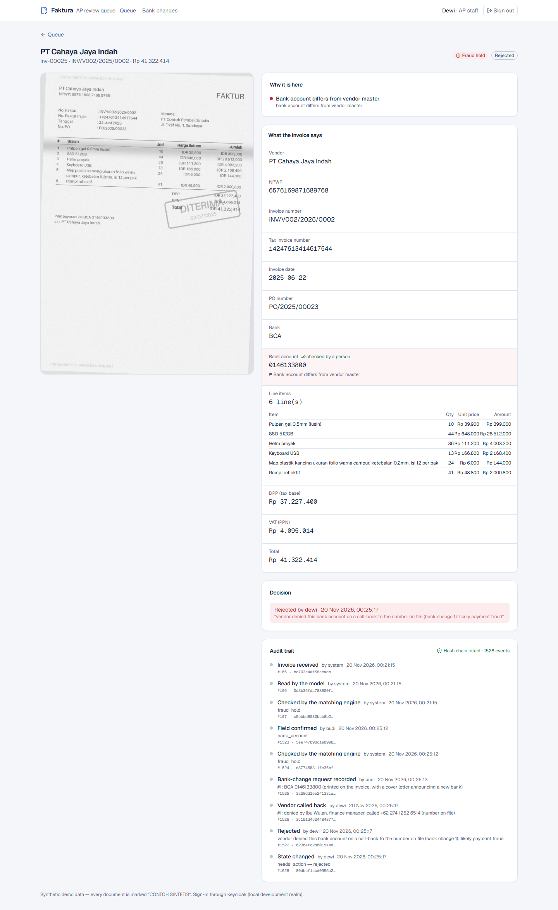
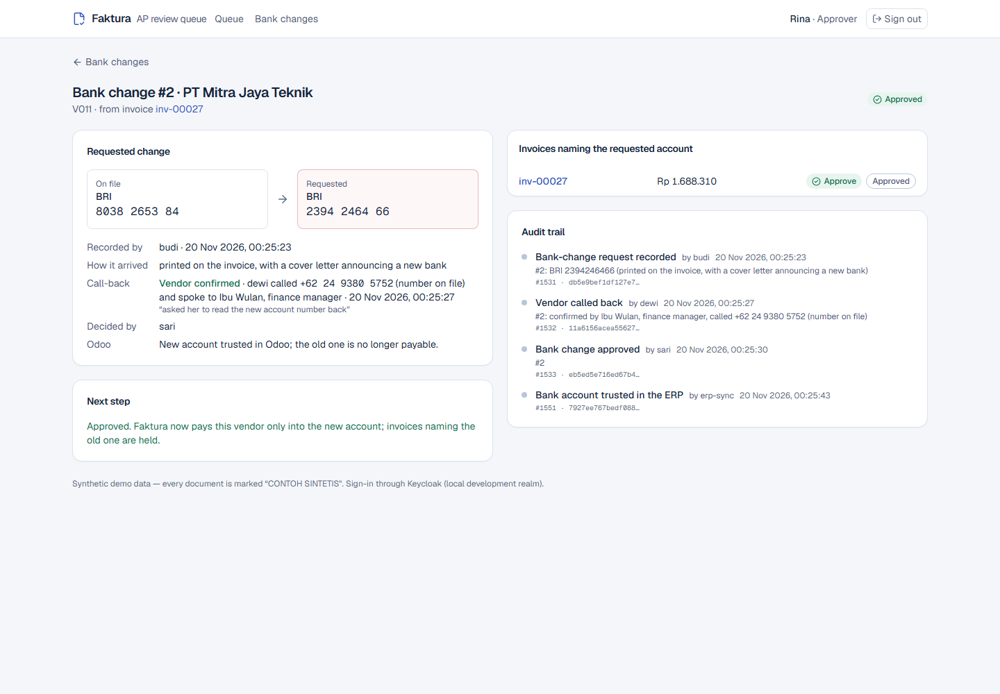

# Vendor bank-account changes

The most common way to steal from an AP team is to ask it to pay a real invoice into a
different account: an email "from the vendor" announcing new bank details, a letter on
copied letterhead, or an invoice that simply prints a new account (business email
compromise). Nothing on the document tells a fraudulent change from a real one. The
only reliable control is to verify the change outside the channel that requested it.

Faktura does not accept a new payee account on an invoice. An invoice whose bank
account or bank differs from the vendor master is held (`fraud_hold`). It cannot be
submitted for payment, even with a justification, and it is released only by an approved
**bank-change request**.

## The workflow

| Step | Who | What Faktura enforces |
|---|---|---|
| 1. Check the page | AP staff | The account is confirmed or corrected against the page first, so a misread never becomes a "change" |
| 2. Record the request | AP staff (Budi) | New account and how it arrived; one open request per vendor |
| 3. Call back | Another AP staff member (Dewi) | Not whoever recorded it. Faktura shows **the number on file** and records that number itself; nobody types it, so a number from the invoice or email cannot be used. No number on file blocks the call-back |
| 4a. Vendor denies | | Request rejected; every open invoice asking to be paid into that account is rejected as likely fraud |
| 4b. Vendor confirms | An approver (Sari) | Not the requester and not the caller. Refused if the account on file changed since the request |
| 5. Apply | System | The new account replaces the old one in the master data used for decisions; open invoices from the vendor are decided again |
| 6. Pay | A different approver (Rina) | Whoever approved the master change cannot also release a payment it unblocked |

With Odoo as the ERP, `faktura-erp-sync` then writes the verified account to Odoo:
creates it if needed, trusts it (`allow_out_payment`), and stops trusting the vendor's
other accounts. Every step checks its own result, so a rerun after a crash does only
what is left. A bill paying into an approved account that Odoo does not trust yet waits
for that write instead of failing. Odoo's own check stays in place: a bill is posted only
into an account Odoo trusts.

Every step is in the hash-chained audit trail, linked to the source invoice.

## Demo

`scripts/e2e_bank_change.py` runs both cases in a real browser, signing in each user
through Keycloak:



Dewi sees the number on file, not one from the invoice, and is asked to have the vendor
read the new account back:



The vendor never changed banks, so the request and the invoice are rejected:



In the second case the vendor confirms, Sari approves the change, Rina approves the
payment, and the bill is posted in Odoo into the newly trusted account:



Both invoices carry the same synthetic label (`bank_account_changed`). Only the call-back
tells them apart, which is the point; the vendor's answer is role-played in the demo.

```bash
uv run python scripts/e2e_bank_change.py --out docs/screenshots --erp
```

The demo changes the vendor's trusted account in Odoo. Rerunning `odoo_seed.py` resets
every vendor to its onboarding account.

## Design choices

- **Master data first, invoice second.** The invoice is evidence that someone asked for a
  change, never proof of it. That is why the old "submit a fraud hold with a vendor
  verification" path no longer applies to bank accounts (it still applies to a changed
  NPWP and to suspected duplicates).
- **Three people.** Requester, caller, and approver are enforced as different users;
  together with role separation (an account holding both roles is refused at sign-in),
  one compromised or dishonest account cannot change where money goes.
- **The integration's rights in Odoo.** Trusting an account needs Odoo's "Validate bank
  account" right, and creating one needs "Contact creation". The `faktura-bot` user holds
  both, so the verification done in Faktura carries through to the ERP. The trade-off: a
  leaked integration key could trust an account in Odoo directly, outside this workflow.
  The key lives only on the server and expires after 90 days. A stricter setup would
  leave the final trust to a named Odoo user and let the bill wait (Faktura already
  waits rather than fails).
- **Phone numbers on file.** The synthetic vendors carry an office phone (generated from
  its own random stream, so adding it changed no other generated value); with Odoo it is
  `res.partner.phone`.

Not built: a cooling-off period before a new account can be paid, notifying the vendor's
old contact of the change, and changing the number on file itself (that would need the
same controls).
