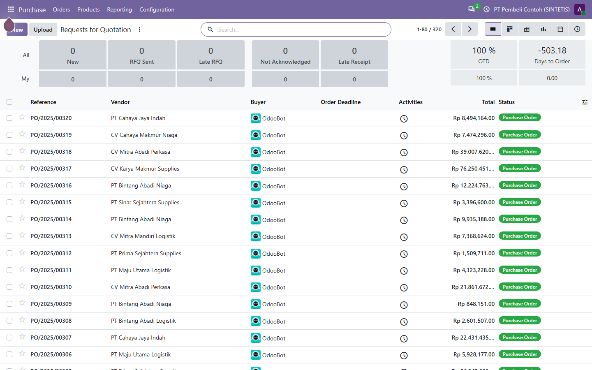
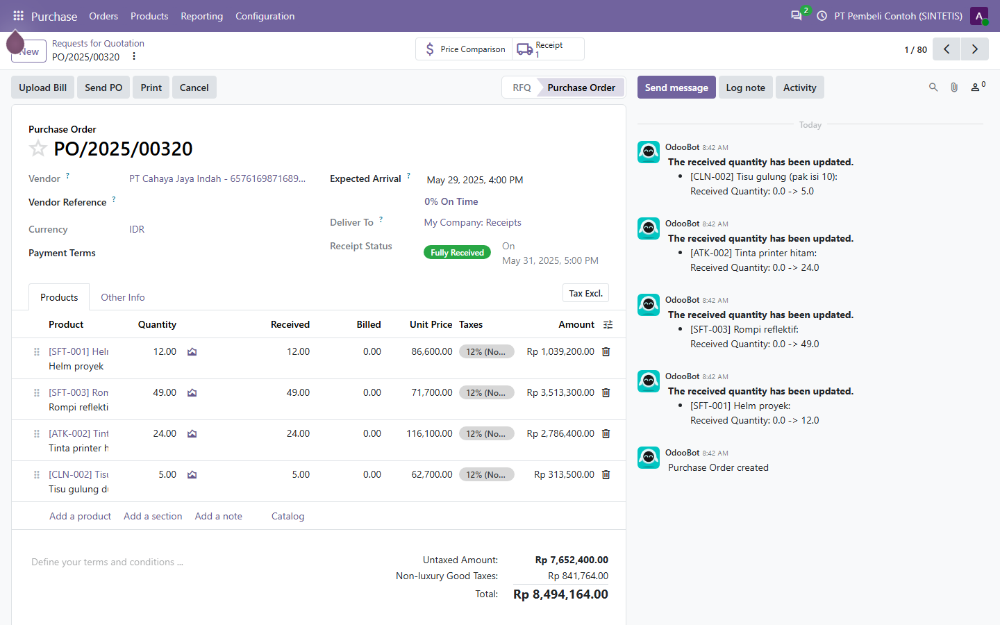
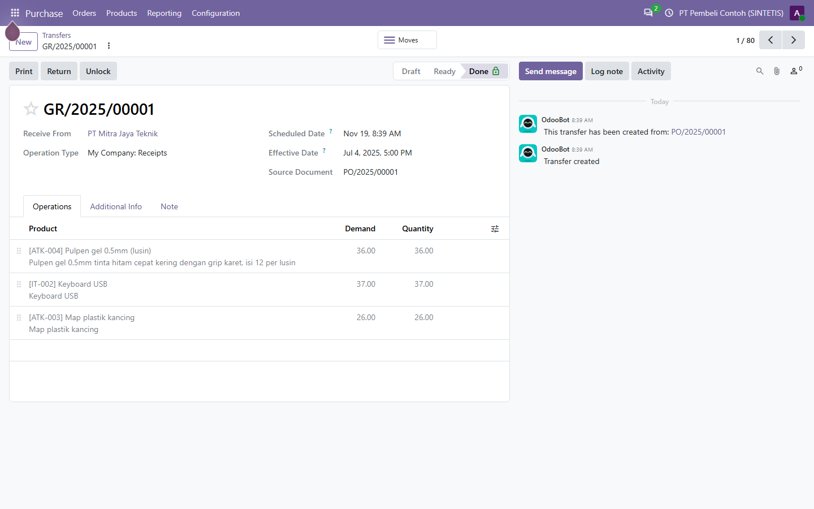
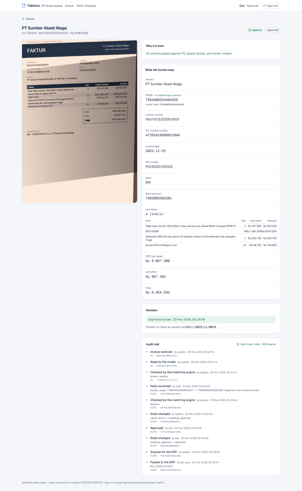

# ERP integration (Odoo 20)

In a real company, vendors, purchase orders, and goods receipts live in the ERP, not in
Faktura. Faktura reads them from there, and the matching engine does not know or care
where they came from: `MasterSource.snapshot()` returns the same `MasterData` either way.

| Source | Used by | Set with |
|---|---|---|
| `files` | evals, tests | default |
| `odoo` | the review-queue service | `FAKTURA_MASTER=odoo` |

**Parity check.** After seeding Odoo from the synthetic files, the master data read back
through the API is identical to the files (15 vendors, 320 POs, 320 receipts;
`tests/test_erp_odoo.py`), and running all 340 invoices through the service gives the
same decision, state, and reasons for 340 of 340. Every `decided` audit event records
which source the decision used.

## Setup

```bash
docker compose --profile erp up -d odoo-db
# Create the database with Purchase, Inventory, Accounting and the Indonesian localization
docker compose --profile erp run --rm odoo -d faktura_erp \
    -i purchase,stock,account,l10n_id --stop-after-init
# Company (IDR, Indonesian chart of accounts) + integration user + API key
docker compose --profile erp run --rm -T -v ./scripts:/faktura-scripts:ro \
    --entrypoint sh odoo -c 'odoo shell -d faktura_erp --no-http --db_host=odoo-db \
    --db_user=odoo --db_password=odoo-dev < /faktura-scripts/odoo_setup.py'
# Put the printed FAKTURA_ODOO_KEY into .env as ODOO_API_KEY, then load the master data:
docker compose --profile erp run --rm -T -v ./scripts:/faktura-scripts:ro \
    -v ./data/synth/v2:/faktura-data:ro --entrypoint sh odoo -c 'odoo shell -d faktura_erp \
    --no-http --db_host=odoo-db --db_user=odoo --db_password=odoo-dev \
    < /faktura-scripts/odoo_seed.py'
docker compose --profile erp up -d odoo        # UI at http://127.0.0.1:8069 (admin / admin)
FAKTURA_MASTER=odoo uv run uvicorn faktura.app.api:app --port 8077
```

The admin password and database credentials are local development defaults. The ports
are bound to 127.0.0.1 only.



## API: JSON-2

Odoo 19 introduced the JSON-2 API (`POST /json/2/<model>/<method>`, bearer API key), and
XML-RPC / JSON-RPC are deprecated (scheduled for removal in Odoo 22). Faktura uses
JSON-2 only (`src/faktura/erp/odoo.py`).

Each JSON-2 call is its own database transaction. Reads are retried on 502/503/504 and
connection errors; writes are never retried automatically, because a write whose response
was lost may already have been committed.

## Access: a dedicated integration user

Faktura authenticates as `faktura-bot`, not as an admin, with Purchase user, Inventory
user, and Billing rights, plus "Validate bank account" and "Contact creation" so it can
write a bank-account change that Faktura's workflow has verified
([`bank-changes.md`](bank-changes.md), including the trade-off). Its API key expires after 90 days (Odoo's limit for
keys a user creates); rerun `odoo_setup.py` to rotate it.

Master data is loaded by `odoo_seed.py` as an admin inside `odoo shell`, the way
purchasing and warehouse staff would enter it. Faktura does not create POs or receipts.

## Field mapping

| Faktura | Odoo 20 | Notes |
|---|---|---|
| `Vendor.vendor_id` | `res.partner.ref` | |
| `Vendor.npwp` | `res.partner.vat` | |
| `Vendor.bank_account`, `bank_name` | `res.partner.bank.account_number`, `bank_name` | trusted accounts only, see below |
| `PurchaseOrder` | `purchase.order` in state `purchase` or `done` | |
| `POLine.sku` | `product.product.default_code` | |
| `POLine.qty`, `unit_price` | `purchase.order.line.product_qty`, `price_unit` | must be whole numbers |
| `GoodsReceipt.gr_number`, `date` | `stock.picking.name`, `date_done` (incoming, done) | |
| `GRLine.qty_received` | `purchase.order.line.qty_received` | Odoo nets out returns |
| VAT 11% | tax "12% (Non-Luxury Good)" | 12% on a DPP of 11/12, effective 11% (PPN from 2025) |





## Bank accounts: only trusted ones count

Odoo marks each vendor bank account as trusted or not (`allow_out_payment`). Only users
with the "validate bank account" right can trust an account, Odoo refuses to let the
system user (OdooBot) or scheduled jobs do it, and a trusted account's number can no
longer be edited. Faktura treats only trusted accounts as master data. So when someone
adds a new account to a vendor in Odoo, invoices paying into it are held as
`fraud_hold` until a person with that right verifies it, and a vendor with no trusted
account cannot be paid automatically at all. A change verified in Faktura (call-back to
the number on file, approval by a third person) is written back by `faktura-erp-sync`:
the new account is trusted and the old one is not.

Master data is cached for 30 seconds, so a change in Odoo reaches decisions within that
time. If Odoo cannot be reached, decisions fail rather than use data of unknown age.

## Writing approved invoices back: vendor bills

When an invoice is approved (automatically or by a checker), the approval and an
`erp_outbox` row are written in the same database transaction. A separate worker posts
each row to Odoo:

```bash
uv run faktura-erp-sync          # keeps running; --once to drain and exit
```

JSON-2 cannot group calls into one transaction, so posting is a sequence of steps that
each check whether they already happened (`src/faktura/erp/odoo_bills.py`):

1. Find the bill by `x_faktura_id` (a custom field created by `odoo_setup.py`), or create
   a draft: lines linked to the PO lines they bill (`purchase_line_id`, so Odoo updates the
   PO's billed quantities), paid into the vendor's **trusted** account that the invoice names.
2. Make the bill equal the vendor's invoice. Odoo computes PPN to the sen; invoices print
   whole rupiah. A gap under Rp 1 is closed by setting the tax amount to the printed one,
   as a clerk would in the UI. Any larger gap is refused.
3. Attach the invoice PDF.
4. Post the bill.

A worker that dies between steps resumes from the draft on the next run; it never creates a
second bill. Network errors and 5xx back off (15 s doubling, up to 8 attempts). Anything a
person must fix (unknown vendor or PO, untrusted bank account, amounts that disagree,
validation errors) becomes `needs_attention`, stays a draft in Odoo, and shows on the
invoice page. Every outcome is in the audit trail (`erp_queued`, `erp_bill_posted`,
`erp_needs_attention`).

**Result.** With all 340 invoices seeded through the service, the worker posted the 165
approved ones in 96 s. Reconciliation: 165 bills in Odoo for exactly the 165 approved
invoice ids, all posted with the PDF attached, every bill total equal to the invoice total
(Rp 2,262,040,029 on both sides), and 6 bills left over from an earlier test run were found
and reused rather than duplicated. The rounding step was checked separately on a draft
with a DPP of Rp 12,345: Odoo computed VAT 1,357.95, the bill was set to the printed 1,357,
and a Rp 5 difference was refused. The synthetic prices are multiples of Rp 100, so the
seeded invoices never needed it.



## The same process in SAP S/4HANA

The concepts map one to one; only the names differ.

| Step | Faktura | Odoo | SAP S/4HANA |
|---|---|---|---|
| Vendor master | `Vendor` | Contact (`res.partner`) | Business Partner (`API_BUSINESS_PARTNER`) |
| Purchase order | `PurchaseOrder` | Purchase → Orders | `ME21N` (`API_PURCHASEORDER_PROCESS_SRV`) |
| Goods receipt | `GoodsReceipt` | Inventory → Receipts | `MIGO`, movement type 101 (`API_MATERIAL_DOCUMENT_SRV`) |
| Three-way match | `matching.decide()` | Bill control on received qty | `MIRO` with tolerance keys |
| Held invoice | review queue | (no equivalent) | payment block, released in `MRBR` |
| Bank account change | `fraud_hold` | untrusted account | dual control on sensitive fields |
| Vendor bill | `faktura-erp-sync` | `account.move`, in_invoice | Supplier invoice (`API_SUPPLIERINVOICE_PROCESS_SRV`) |
