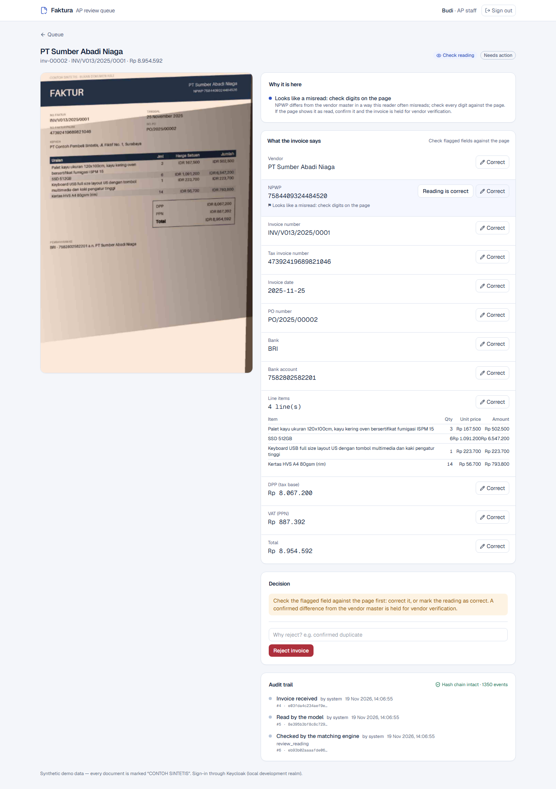

# Learning from corrections

Every correction AP staff make is a labelled example of how the reader fails. Faktura
uses those examples to cut false fraud alarms, without giving a fraudster a new way to
get paid.

## The problem: misreads that look like fraud

A bank account or NPWP that differs from the vendor master is held as `fraud_hold`,
because changed payment details are the classic AP fraud. But on poor scans and photos
the reader also misreads these numbers. After the re-read, **39 of the 241 clean
invoices sat in the fraud queue only because of a misread**. A fraud queue in which 43%
of the alerts are false trains people to wave alerts through.

The misreads are not random. Aligned against what is printed, the corrections are almost
all one or two edits of a few kinds:

| Edit | Seen | Meaning |
|---|---|---|
| `6>0` | 23 | a printed 6 read as 0 |
| `9>0` | 18 | 9 read as 0 |
| `6>8` | 16 | 6 read as 8 |
| `5>6` | 13 | 5 read as 6 |
| `ins-dup` | 8 | a digit read twice |
| `ins` | 7 | an extra digit |
| `9>8`, `del`, `swap`, `8>0`, `8>6` | 3–5 each | |

A fraudster's account is a different number, not "the vendor's account with a 6 read as
0", so the two cases can be told apart.

## How it works

1. **Learn.** `faktura-learn` reads the `field_corrected` events from the audit trail
   (only if the hash chain verifies), aligns each identifier correction (model read vs.
   printed), and counts the edit types (`src/faktura/learn/misread.py`). The model is a
   table of counts: auditable ("6 read as 0, seen 23 times"), additive, and versioned by
   content (`misread-n72-0f1d435b`). Retraining is a deliberate batch step, so the same
   invoice always gets the same decision from the same model version, and every
   `decided` audit event records which version was used.
2. **Triage.** When an NPWP or bank account differs from the master, and the difference is
   at most two edits that the model has seen at least three times each, the reason becomes
   `probable_misread` (review_reading) instead of `fraud_hold`.
3. **Check the page, then decide.** The clerk compares the flagged field with the page:
   - read wrong: correct it; it now matches the master, and maker-checker applies as for
     any human change;
   - read right: confirm it; the master comparison applies again and the invoice is held
     for vendor verification.
   An invoice with `probable_misread` **cannot be submitted** until that check is done, so
   a payee change can never reach an approver without the vendor verification a fraud
   hold requires.

What the triage never does: approve anything, show the master value, or name the
suspected digits. A clerk shown "the master has a 6 here" could type the master value
in and make a fraudulent invoice look clean.



## Results

`faktura-eval-learn --runs runs/luna-v2-reread-tiles-final runs/luna-v2-reread-pilot-tiles runs/luna-v2`

The 340 invoices are replayed in arrival order with the real model readings. Whenever an
invoice goes to a person, a simulated clerk corrects misread identifiers to the printed
value. The model used for invoice *i* is fitted only on corrections to invoices before
*i*.

| | No learning | Learning from corrections |
|---|---|---|
| Invoices in fraud_hold | 90 | 70 |
| Clean invoices in fraud_hold (false alarms) | 39 | **20** |
| fraud_hold precision | 0.57 | **0.71** |
| Changed NPWP / bank account still held | 25 / 25 | **25 / 25** |
| Approved automatically | 165 | 165 (unchanged by design) |

22 clean invoices were triaged as probable misreads, and the page check cleared all 22.
One real bank-account change was on an invoice whose NPWP was also misread: the NPWP was
triaged, the bank account was not, and the invoice stayed held.

**Learning curve.** The model is fitted on the first *N* corrections from the first half
of the stream and measured on the second half (baseline: 16 false alarms):

| Corrections | Known edit types | False alarms | Precision | Changed NPWP/bank held |
|---|---|---|---|---|
| 0 | 0 | 16 | 0.58 | 12/12 |
| 10 | 1 | 13 | 0.63 | 12/12 |
| 25 | 5 | 9 | 0.71 | 12/12 |
| 42 | 6 | 7 | 0.75 | 12/12 |

**Adversarial.** An attacker who knows the reader's most common misread changes one digit
of a vendor's bank account or NPWP to exactly that (235 attempts on clean invoices). All
235 are triaged to review_reading, so **the attacker can get past the fraud label**. None
is paid: all 235 are held once the clerk confirms the page, and none can be submitted
before that check. The page check is what stops this attack, not the model.

Limits, stated plainly: the confusions come from synthetic scan and photo damage, so a
real reader's confusions will differ (which is why they are learned, not hard-coded). The
clerk is simulated as always checking correctly; a clerk who types a value without
looking at the page is a process risk that maker-checker reduces but does not remove. An
insider could also enter fake corrections to teach the model an edit; the threshold of
three sightings, the audit trail, and the "triage only" rule limit what that buys.

## Negative result: learned hints in the re-read prompt

The same counts can be turned into advice for the re-read prompt ("a printed 6 is often
read as 0; check for these specifically"). The advice names kinds of mistakes, never
values, so it cannot steer a reading towards the master. It was tested on the 300
held-out invoices, with hints learned only from the 40 dev invoices, and the baseline
was run again to measure run-to-run noise:

| Re-read (tiles), held-out | Invoices fully correct | Fields fixed / broken |
|---|---|---|
| Original run | 73.0% | 140 / 7 |
| Same configuration, run again | 72.0% | 138 / 10 |
| Plus learned hints | **66.9%** | 60 / 1 |

**Not adopted.** With the hints, the model changed only 70 of the 369 fields it was asked
to re-read (237 without), so most misreads simply stayed. The likely cause is that it
returned null more often and the pipeline kept the first reading; the raw second-read
output is not stored, so this is not verified. Telling the model about its own mistakes
made it hesitant, not careful. The option stays (`--misread-model`) for reproducibility.

A side finding from the baseline rerun: on one phone photo, the re-read returned the VAT
that *should* have been charged instead of the miscalculated VAT printed on the invoice,
so the field-level VAT flag disappeared. The invoice was still stopped, because DPP +
VAT no longer added up to the printed total. With these readings, no anomalous invoice
was approved.

## Commands

```bash
uv run faktura-eval-learn --runs runs/luna-v2-reread-tiles-final runs/luna-v2-reread-pilot-tiles runs/luna-v2
uv run faktura-learn --out models/misread.json --export corrections.jsonl   # from the audit trail
FAKTURA_MISREAD_MODEL=models/misread.json uv run uvicorn faktura.app.api:app --port 8077
```
