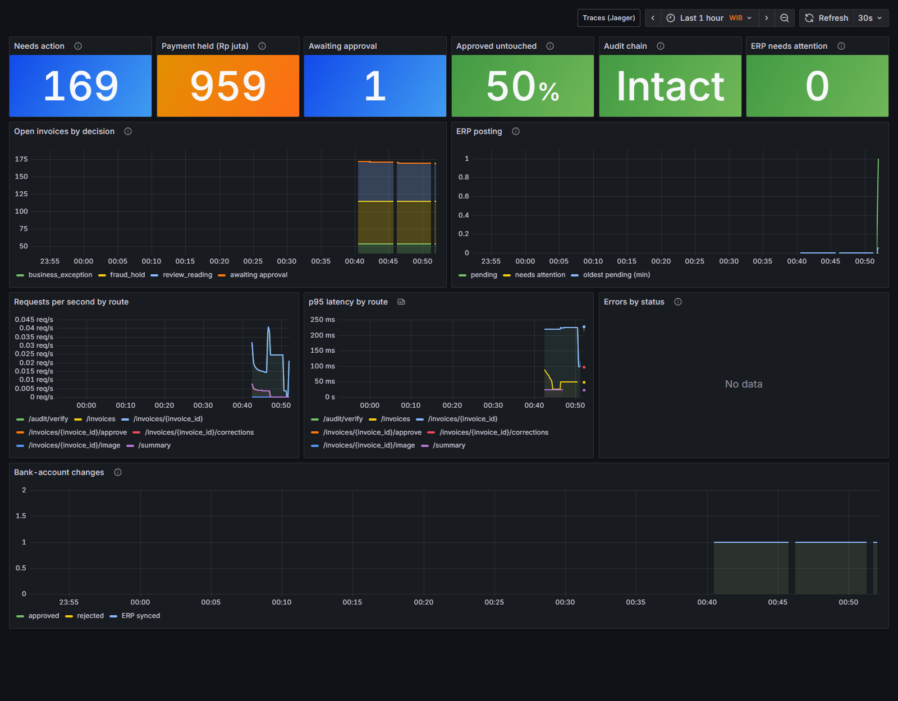
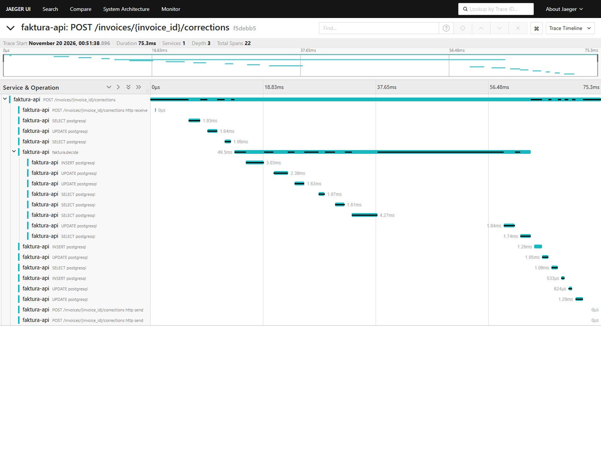

# Observability

Three questions an AP team and its operators need answered without opening a database:
**is money stuck** (invoices held, approvals waiting, bills not reaching the ERP), **is
the record intact** (audit hash chain), and **is the service healthy** (errors, latency).
Faktura answers them with Prometheus metrics, a Grafana dashboard with alert rules, JSON
request logs, and OpenTelemetry traces.

```bash
docker compose --profile obs up -d     # Prometheus :9090, Grafana :3300, Jaeger :16686
export FAKTURA_METRICS_PORT=9077                       # metrics on 127.0.0.1:9077
export OTEL_EXPORTER_OTLP_ENDPOINT=http://127.0.0.1:4318   # traces to Jaeger
uv run uvicorn faktura.app.api:app --port 8077
```

Both are off unless set, so tests and plain local runs need nothing.

## Metrics

Served on a separate port bound to 127.0.0.1 (`src/faktura/app/observability.py`), so
the API's sign-in rules stay as they are and the numbers (amounts held, queue sizes) are
not exposed on the API port.

| Metric | What it answers |
|---|---|
| `faktura_http_requests_total{method,route,status}` | traffic, 4xx refusals, 5xx errors |
| `faktura_http_request_duration_seconds{method,route}` | latency (histogram) |
| `faktura_invoices{state,decision}`, `faktura_invoice_amount_rupiah{...}` | the queue, and how much money is held |
| `faktura_erp_outbox{status}`, `faktura_erp_outbox_oldest_pending_seconds` | approved invoices not yet in the ERP |
| `faktura_bank_changes{status}`, `faktura_bank_changes_erp{erp_status}` | payee changes waiting, or not written to the ERP |
| `faktura_audit_chain_ok`, `faktura_audit_events` | whether history was tampered with |
| `faktura_db_up` | whether the database could be read |

The route label is the path template (`/invoices/{invoice_id}`), never the raw path, so
the number of series stays bounded. The work metrics are gauges read from the database at
scrape time (cached 10 s; the chain check, which reads every event, at most once a
minute): the database is the record of what is waiting, so the numbers are right after a
restart and agree with the review queue.

## Dashboard and alerts



Provisioned from `observability/grafana/`; Grafana opens on it (anonymous read-only
viewer, local only). Alert rules (`observability/alerts.yml`, checked with `promtool`):

| Alert | When |
|---|---|
| AuditChainBroken | the hash chain no longer verifies |
| FakturaApiDown | the API or its database cannot be read for 2 min |
| ErpPostingNeedsAttention | the ERP refused an approved invoice |
| ErpPostingBacklog | an approved invoice has waited over 15 min (is the worker running?) |
| BankChangeNotInErp | a verified bank change could not be written to the ERP |
| ApiServerErrors | over 5% of requests fail with 5xx for 5 min |
| ApiSlow | p95 latency above 2 s for 10 min |

Alerts are evaluated in Prometheus; no Alertmanager or notification channel is set up.

## Request logs

One JSON line per request on stderr: request id (taken from `X-Request-ID` if it is
well-formed, else generated, and returned in the response), method, route, path, status,
duration, user, and the trace id when tracing is on, so a log line leads to its trace.

```json
{"ts": "2026-11-19T17:35:04.025+00:00", "level": "info", "logger": "faktura.request", "msg": "request", "request_id": "276b289c...", "method": "GET", "route": "/invoices/{invoice_id}", "path": "/invoices/inv-00001", "status": 200, "duration_ms": 15.8, "user": "budi", "trace_id": null}
```

## Traces

With `OTEL_EXPORTER_OTLP_ENDPOINT` set, the API and `faktura-erp-sync` export OTLP
traces: a span per request (FastAPI instrumentation), per SQL statement, per call to
Odoo (httpx instrumentation), and `faktura.decide` around each matching decision with the
decision and reason codes. The worker groups each bill's Odoo calls under one
`erp.post_bill` span.

SQL spans are hand-rolled on SQLAlchemy's cursor events, because the contrib SQLAlchemy
instrumentor (0.66b2) refuses SQLAlchemy 2.1. They carry the statement text only, never
the parameters, which hold bank accounts and amounts.



**What the first traces showed.** A field correction took 588-724 ms. Six Odoo calls sat
inside the decision whenever the master-data cache had expired (it is now refreshed in
the background), and most of the rest was `build_ledger` replaying, with fuzzy line
matching, the billing of every earlier invoice; it now replays only the invoice's own PO.
Same decisions for all 340 invoices, 454 → 25 ms per decision, 724 → 75 ms per
correction. Details in [`experiments.md`](experiments.md).

## Not built

Metrics from the worker process itself (its effects are visible through the outbox
gauges), extraction metrics in production (latency and cost are measured in the offline
evals), log shipping, and alert notifications.
